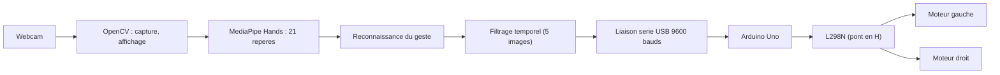

# Robot commandé par les gestes de la main — Projet MP2I

## Qui et quoi

- **Étudiant 1 :** Romain CHEN
- **Étudiant 2 :** Mohammed MOUSSAOUI
- **Enseignante :** E. SABAHI
- **Projet :** une voiture robot à deux roues motrices pilotée par les gestes de la main devant la webcam, en Python (OpenCV, MediaPipe), avec une carte Arduino qui commande les moteurs
- **Dépôt GitHub :** https://github.com/Answy-L/MP2I-Informatique
- **Dernier commit avant rendu :** ⚠️ à compléter au rendu final
- **Changement de sujet :** la première piste explorée (détecteur de formes BMP en C, séances 1 à 7 du journal de bord) a été abandonnée le 03/11/2026 ; le passage au projet Python + Arduino a été validé par l'enseignante. Cette première piste reste visible dans l'historique Git du dépôt.

---

## 1. Présentation

La webcam capture la main en temps réel. MediaPipe détecte les 21 repères de la main, le programme Python reconnaît le geste, filtre les détections instables, puis envoie une commande à l'Arduino par le port série USB. L'Arduino commande les deux moteurs à courant continu via un driver L298N. Le robot s'arrête automatiquement si la main disparaît, si le geste est inconnu, si la liaison série est perdue ou si le programme est fermé.

| Fonctionnalité | Détail |
|---|---|
| Capture vidéo | webcam via OpenCV, image en miroir, 21 repères dessinés |
| Détection de la main | MediaPipe Hands, une seule main |
| Reconnaissance | cinq gestes : main ouverte, poing fermé, signe V, index seul, pouce levé |
| Filtrage temporel | un geste n'est validé qu'après 5 images consécutives identiques |
| Liaison série | commandes `F` / `B` / `L` / `R` / `S` + saut de ligne, 9600 bauds, heartbeat toutes les 200 ms |
| Sécurités | arrêt si main absente depuis 0,5 s, si geste inconnu, à la fermeture, et watchdog Arduino à 500 ms |
| Mode démo | sans Arduino branché, le programme tourne quand même (test de la vision seul) |



### Gestes et commandes

| Geste (une main, paume face à la caméra) | Commande | Action |
|---|---|---|
| Main ouverte (4 doigts et pouce étendus) | F | Avancer |
| Poing fermé | S | Arrêter |
| Signe V (index et majeur levés) | R | Tourner à droite |
| Index seul levé | L | Tourner à gauche |
| Pouce levé | B | Reculer |
| Geste non reconnu | S | Arrêt par sécurité |
| Main absente | S après 0,5 s | Arrêt |

---

## 2. Analyse

### Ce qu'il faut faire

On part d'un flux vidéo et on doit arriver à des ordres moteurs sûrs et stables. Trois difficultés principales :

- **Reconnaissance** : identifier cinq gestes à partir des 21 repères, de façon assez fiable pour piloter un objet qui roule. Un geste douteux ne doit jamais déclencher un déplacement.
- **Stabilité** : la détection fluctue d'une image à l'autre (main qui bouge, repères instables) ; il faut éviter les ordres fugitifs.
- **Sécurité** : le robot doit s'arrêter tout seul dans tous les cas de panne imaginables : main retirée, geste inconnu, câble débranché, programme fermé ou planté.

### Contraintes

- La reconnaissance doit rester correcte même si la main est penchée : un simple test de hauteur des doigts (comparer les y) échoue dès que la main n'est plus droite. On utilise donc des comparaisons de distances, insensibles à l'orientation dans le plan de l'image.
- Le « pouce levé » doit être distingué d'un poing fermé, alors que replié dans le poing, le pouce garde souvent son articulation droite : c'est le geste le plus fragile, il faut un seuil réglable et assumer cette limite.
- La sécurité ne doit pas dépendre uniquement de Python : l'Arduino doit couper les moteurs d'elle-même si aucun message n'arrive pendant 500 ms (watchdog).
- Environnement : Windows, Python 3.12, webcam de l'ordinateur, budget matériel d'environ 50 €.
- L'Arduino ne fait aucune reconnaissance d'image : elle reçoit une lettre et commande les moteurs.

### Idée directrice : un pipeline et deux couches de sécurité

Chaque étape du pipeline est testable séparément (webcam seule en mode démo, test des moteurs sans webcam), ce qui permet de progresser sans risque.

---

## 3. Conception

### Choix techniques

| Élément | Choix | Justification |
|---|---|---|
| Langage | Python 3.12 | déjà installé, bibliothèques de vision faciles à utiliser |
| Vision | OpenCV (capture, affichage) + MediaPipe Hands | repères précis de la main en quelques lignes |
| Liaison | PySerial, USB, 9600 bauds | simple et fiable pour quelques caractères par seconde |
| Carte | Arduino Uno R3 | disponible au lycée, entrées-sorties et PWM simples |
| Moteurs | châssis 2WD + driver L298N | deux moteurs DC courant, pont en H double bon marché |
| Alimentation | 4 piles AA ou 2 batteries 18650 | adaptée aux moteurs 3 à 6 V des châssis classiques |

### Découpage en modules

| Fichier | Rôle |
|---|---|
| `hand_robot.py` | capture, affichage des 21 repères, classification des gestes, filtrage temporel (classe `GestureFilter`), liaison série et heartbeat (classe `SerialLink`), fermeture propre |
| `arduino_robot/arduino_robot.ino` | réception série, commande du L298N, vitesse PWM réglable, watchdog 500 ms |
| `test_moteurs/test_moteurs.ino` | test des moteurs sans webcam ni Python (séquence arrêt / avant / arrière / gauche / droite) |
| `tests/test_gestes.py` | tests automatiques de la logique de reconnaissance, sans matériel |
| `docs/cahier_des_charges.md` | cahier des charges du projet |

### Reconnaissance des gestes

Pour chaque doigt, on compare la distance de sa pointe au poignet avec celle de son articulation PIP : un doigt étendu a sa pointe plus loin du poignet, un doigt plié la ramène vers la paume. Cette méthode reste valable main penchée ou tournée (elle est testée avec une main tournée de ±45° et 90° dans `tests/test_gestes.py`), contrairement à un test de hauteur. Le pouce utilise une comparaison de distances à la base de l'auriculaire, avec un facteur de marge (1,2) réglable en haut du fichier : c'est le point le plus délicat, documenté dans le bilan.

Un geste n'est envoyé que s'il est observé sur 5 images consécutives. Tout geste non reconnu, ambigu (par exemple index levé ET pouce levé) ou toute absence de main au-delà de 0,5 s conduit à la commande S : le programme ne donne jamais un ordre de déplacement sur une détection incertaine.

### Protocole série

Format : une lettre suivie d'un saut de ligne (`F\n`), 9600 bauds, identique des deux côtés.

| Lettre | Action |
|---|---|
| F | avancer |
| B | reculer |
| L | tourner à gauche |
| R | tourner à droite |
| S | arrêt |

- Python renvoie la commande en cours toutes les 200 ms même si le geste ne change pas (heartbeat).
- L'Arduino mémorise l'heure du dernier message reçu et coupe les moteurs au-delà de 500 ms sans message.
- À la fermeture, Python envoie S si le port est encore ouvert ; au démarrage et après une reconnexion, le robot reste arrêté jusqu'au prochain geste validé.
- L'Arduino ignore les fins de ligne et les caractères inconnus, sans jamais bloquer la surveillance du timeout.

### Câblage

| Arduino Uno | L298N |
|---|---|
| D5 (PWM) | ENA |
| D7 | IN1 |
| D8 | IN2 |
| D9 | IN3 |
| D10 | IN4 |
| D6 (PWM) | ENB |
| GND | GND |

- Moteur gauche sur OUT1/OUT2, moteur droit sur OUT3/OUT4.
- Retirer les cavaliers ENA et ENB du L298N pour régler la vitesse par PWM.
- Relier la masse de l'Arduino et celle de l'alimentation des moteurs.
- Ne jamais alimenter les moteurs depuis le 5 V de l'Arduino ; vérifier la notice du module pour son cavalier 5 V.
- Interrupteur sur l'alimentation des moteurs, à portée de main.

### Composants et budget

| Élément | Statut | Fourchette |
|---|---|---|
| Arduino Uno R3 (clone compatible) | indispensable | 8 à 15 € |
| Châssis voiture 2WD (2 moteurs, roues, roue folle) | indispensable | 10 à 20 € |
| Module L298N | indispensable | 3 à 7 € |
| Boîtier de piles (4 AA ou 2 18650) | indispensable | 3 à 8 € sans piles |
| Fils Dupont, câble USB A-B, interrupteur | indispensables | 8 à 15 € ensemble |
| Webcam | déjà possédée | 0 € |
| Capteur ultrason HC-SR04 (amélioration) | optionnel | 2 à 4 € |

Fourchettes indicatives hors livraison (3 à 8 € selon le vendeur) ; l'ensemble reste autour de 40 à 50 €.

---

## 4. Démarche de réalisation

### Journal de bord

**Séance 1 — 06/10/2026 : lancer le dépôt GitHub du binôme.**
Création du dépôt et ajout des premiers fichiers via upload (commit `14dbdda`). C'était la première utilisation de Git à deux, ça a pris un peu de temps. Prochaine étape : mettre en place le README et le `.gitignore`.

**Séance 2 — 13/10/2026 : organiser le dépôt.**
Ajout du README initial et du `.gitignore` (commit `e24dfc1`, poussé le 12/10) en suivant le guide GitHub, VS Code et WSL. L'enseignante a validé le sujet à l'oral : détecteur de formes dans les images BMP en C pur (la confirmation écrite n'est pas encore obtenue). Prochaine étape : étudier le format BMP en détail.

**Séance 3 — 20/10/2026 : analyser le format BMP.**
Étude du format BMP 24 bits sur papier et avec de la documentation : en-tête de 54 octets, nombres stockés en petit-boutiste, lignes arrondies à un multiple de 4 octets, pixels dans l'ordre bleu, vert, rouge, lignes stockées de bas en haut. On a eu du mal au début avec le petit-boutisme et le padding. Prochaine étape : concevoir le programme.

**Séance 4 — 27/10/2026 : concevoir le programme.**
Sur papier : structure `Image` (largeur, hauteur, tableau de niveaux de gris), découpage du projet en jalons (lecture BMP, puis binarisation et comptage, puis détection de formes) et liste des 12 cas de tests. Le brouillon du squelette de `bmp.c` a aussi été commencé. Le plus dur a été de décider comment gérer les erreurs de `fopen` et `malloc`. Prochaine étape : rédiger le README complet.

**Séance 5 — 01/11/2026 : rédiger le README du projet.**
Rédaction du README complet à partir des notes : identification, analyse, conception et plan de tests (commit `3975cd1`). Puis l'identification du binôme a été complétée (`df0d392`) et le texte a été entièrement reformulé et relu par les deux élèves (`cb92181`). On a veillé à ce que le texte soit vraiment de nous. Prochaine étape : poser le squelette du jalon 1.

**Séance 6 — 02/11/2026 : jalon 1, poser le squelette du code.**
Commit `b52bdcf` : `bmp.h` complet, `bmp.c` en squelette guidé avec `liberer_image` déjà donnée, `main.c` qui teste le chargement (attendu : 64 x 48 px et 496 pixels noirs), `Makefile` avec gcc, et `tests/generer_image.py` qui génère `formes01.bmp`. Problème : gcc n'est pas disponible sur l'ordinateur de travail, impossible de compiler tout de suite. Prochaine étape : écrire `lire_bmp`.

**Séance 7 — 03/11/2026 : jalon 1, écrire `lire_bmp`.**
Un membre du binôme a écrit la fonction, l'autre l'a relue. Elle a été vérifiée sur 3 cas : `formes01.bmp` doit donner 64 x 48 et 496 noirs ; une image de 65 x 20 avec padding place bien le carré au bon endroit ; et les fichiers invalides (mauvaise signature, fichier tronqué, fichier inexistant) renvoient `NULL` proprement. Reste à compiler en local. Deux points à surveiller, traités : `entete[21] << 24` peut être un comportement indéfini sur un `int` signé (corrigé : les décalages se font sur `unsigned` avant d'être convertis en `int`), et la hauteur négative n'est pas gérée (documentée comme limite).

**Séance 8 — 03/11/2026 : changement de sujet.**
On a appris que le projet de base en Python était possible : un programme qui traque la main à la webcam, reconnaît des gestes, puis commande une carte Arduino qui actionne des moteurs (il faut une action physique concrète). Le changement a été validé par l'enseignante. La première piste C reste dans l'historique Git du dépôt. Prochaine étape : écrire le programme Python.

**Séance 9 — 09/11/2026 : programme complet et restructuration du dépôt.**
Écriture de `hand_robot.py` : capture OpenCV, repères MediaPipe, reconnaissance des cinq gestes par comparaisons de distances (pour rester correcte main penchée), filtrage sur 5 images, liaison série avec heartbeat toutes les 200 ms et fermeture propre. Programmes Arduino : `arduino_robot.ino` (watchdog 500 ms, PWM réglable) et `test_moteurs.ino` (test sans webcam). Ajout de tests automatiques (`tests/test_gestes.py`) qui vérifient la logique sans matériel : les cinq gestes, les gestes ambigus (qui donnent l'arrêt) et la reconnaissance main tournée de ±45° et 90° passent. Le dépôt a été restructuré : retrait des fichiers C (l'historique Git les conserve), ajout du cahier des charges dans `docs/`. Prochaine étape : recevoir le matériel, assembler et tester avec le vrai robot.

### Jalons et avancement

1. Programme Python de vision et de commande — **fait (séance 9)**.
2. Programmes Arduino (commande + test moteurs) — **faits (séance 9)**.
3. Tests automatiques de la logique de reconnaissance — **faits (séance 9)**, tous passés.
4. Assemblage du robot (châssis, L298N, alimentation, interrupteur) — à faire.
5. Campagne de tests matériels (roues levées puis sol, section 6) — à faire.
6. Réglages sur le matériel réel (vitesse, sens des roues, seuil du pouce) et bilan final — à faire.

### Problèmes rencontrés et solutions

| Problème | Solution | Séance(s) / commit(s) |
|---|---|---|
| Nombres de l'en-tête BMP incompréhensibles au début (première piste) | Étude du petit-boutisme : reconstruction des entiers octet par octet | Séance 3 (première piste) |
| gcc indisponible sur l'ordinateur de travail (première piste) | Code écrit, relu et vérifié sur papier d'abord | Séance 6 (première piste) |
| Un test de hauteur des doigts échoue dès que la main est penchée | Classification par comparaisons de distances au poignet et à la base de l'auriculaire, testée à ±45° et 90° | Séance 9 |
| « Pouce levé » difficile à distinguer d'un poing fermé | Facteur de marge réglable (1,2) + filtrage sur 5 images + limite assumée dans le bilan | Séance 9 |
| Ordres fugitifs quand la détection fluctue | Validation d'un geste seulement après 5 images consécutives identiques | Séance 9 |
| Risque que le robot continue si Python plante | Watchdog côté Arduino : arrêt des moteurs si aucun message pendant 500 ms | Séance 9 |
| Robot qui repartirait seul après une reconnexion du câble | À la reconnexion, le filtre est remis à zéro : le robot reste arrêté jusqu'au prochain geste validé | Séance 9 |

### Reste à faire avant le rendu

- Recevoir le matériel (carte, châssis 2WD, L298N, piles) et assembler le robot.
- Suivre la procédure de test complète (section 6) et consigner les résultats réels dans le tableau de jeux d'essais.
- Régler sur le vrai robot : vitesse PWM, sens des roues, éventuellement le seuil du pouce.
- Remplir la répartition effective du travail et les bilans individuels.
- Compléter la date du dernier commit.

---

## 5. Installation et utilisation

**Prérequis :** Windows, Python 3.12, une webcam, une Arduino Uno, l'IDE Arduino. MediaPipe supporte Python 3.9 et plus ; une version récente s'installe directement sur Python 3.12.

```bash
py -3.12 -m pip install opencv-python mediapipe pyserial
```

En cas d'échec de l'installation, créer un environnement virtuel plutôt que d'essayer des versions au hasard :

```bash
py -3.12 -m venv .venv
.venv/Scripts/activate
python -m pip install --upgrade pip
pip install opencv-python mediapipe pyserial
```

Téléverser les programmes avec l'IDE Arduino : `test_moteurs/test_moteurs.ino` d'abord (test des moteurs), puis `arduino_robot/arduino_robot.ino` (programme principal). Trouver le port COM dans le Gestionnaire de périphériques, section Ports (COM et LPT), puis lancer :

```bash
py -3.12 hand_robot.py            # port COM défini en haut du fichier
py -3.12 hand_robot.py COM4       # ou port passé en argument
```

Quitter avec `q` ou Échap : le programme envoie S puis ferme la caméra, MediaPipe et le port série.

---

## 6. Tests

### Tests automatiques (sans matériel)

```bash
py -3.12 tests/test_gestes.py
```

| Vérification | Résultat |
|---|---|
| Les cinq gestes sont classés correctement (F, S, R, L, B) | OK |
| Geste inconnu (trois doigts) : arrêt par sécurité | OK |
| Geste ambigu (index + pouce levés) : arrêt par sécurité | OK |
| Même main tournée de -45°, +45° et 90° : même commande | OK |
| Filtrage : validation après 5 images consécutives, pas avant | OK |
| Main absente / geste inconnu : commande S | OK |

⚠️ Ces tests valident la logique de reconnaissance, pas la qualité de MediaPipe sur de vraies images : à confirmer avec la webcam pendant les tests matériels.

### Procédure matérielle progressive

1. Webcam seule (mode démo, sans Arduino) : la fenêtre vidéo s'ouvre.
2. Les 21 repères s'affichent sur la main.
3. Chaque geste affiche le bon nom et la bonne commande, sans Arduino.
4. Liaison série avec l'Arduino, moteurs débranchés : le voyant TX de la carte clignote toutes les 200 ms.
5. `test_moteurs.ino`, roues levées du sol : vérifier le sens de rotation de chaque roue.
6. Programme complet à basse vitesse, espace dégagé.
7. Cacher la main (arrêt immédiat), débrancher l'USB en roulant (arrêt en 500 ms maximum).
8. Quitter avec `q` : le robot s'arrête.

### Jeux d'essais matériels

| # | Catégorie | Entrée | Résultat attendu | Résultat obtenu |
|---|---|---|---|---|
| 1 | Normal | main ouverte à 30-60 cm, paume face caméra | commande F, le robot avance | ⚠️ |
| 2 | Normal | poing fermé | commande S, arrêt | ⚠️ |
| 3 | Normal | signe V | commande R, tourne à droite | ⚠️ |
| 4 | Normal | index seul | commande L, tourne à gauche | ⚠️ |
| 5 | Normal | pouce levé | commande B, recule | ⚠️ |
| 6 | Cas limite | main penchée d'environ 45° | le geste est reconnu pareil | ⚠️ |
| 7 | Cas limite | geste non reconnu (trois doigts) | arrêt par sécurité | ⚠️ |
| 8 | Cas limite | main retirée de l'image | arrêt en moins d'une seconde | ⚠️ |
| 9 | Sécurité | câble USB débranché en roulant | arrêt en 500 ms maximum (watchdog) | ⚠️ |
| 10 | Sécurité | fermeture du programme avec q | le robot s'arrête avant la fermeture | ⚠️ |
| 11 | Sécurité | reconnexion du câble | le robot reste arrêté après la reconnexion | ⚠️ |
| 12 | Robustesse | session de 5 minutes avec gestes variés | pas de plantage, arrêts corrects | ⚠️ |

### Dépannage

| Symptôme | Cause probable | Vérification | Correction |
|---|---|---|---|
| La fenêtre vidéo ne s'ouvre pas | webcam occupée ou `CAM_INDEX` erroné | fermer Zoom/Teams, essayer `CAM_INDEX = 1` | libérer la webcam, changer l'index |
| Les repères n'apparaissent pas | lumière insuffisante, main trop loin | main à 30-60 cm, lumière frontale | améliorer l'éclairage |
| Le port COM ne s'ouvre pas | mauvais port ou moniteur série ouvert | Gestionnaire de périphériques, IDE Arduino | bon port, fermer le moniteur série |
| Le geste change sans arrêt | filtrage trop court | `STABLE_FRAMES = 5` | augmenter à 7-10 |
| Le robot ne bouge pas | cavaliers ENA/ENB en place, PWM trop bas | retirer les cavaliers, `VITESSE` > 100 | corriger puis remonter `VITESSE` |
| Une roue tourne à l'envers | polarité du moteur | roues levées avec `test_moteurs.ino` | inverser les deux fils du moteur |
| Le robot s'arrête tout le temps | heartbeat absent ou trop lent | le voyant TX clignote toutes les 200 ms | garder `HEARTBEAT_INTERVAL_S = 0.2` |
| « Pouce levé » confondu avec le poing | seuil du pouce inadapté | affichage du geste à l'écran | ajuster `THUMB_EXTEND_FACTOR` |

---

## 7. Bilan

### Limites connues

- La reconnaissance est fiable paume face à la caméra, main raisonnablement penchée. Vue de profil ou en lumière faible, la détection des 21 repères elle-même se dégrade : c'est la condition de fonctionnement, documentée.
- Le « pouce levé » reste le geste le plus fragile à distinguer du poing fermé : le facteur de marge et le filtrage réduisent les erreurs, mais un réglage sur le vrai matériel sera peut-être nécessaire.
- Le robot ne détecte pas les obstacles.
- Le sens réel des roues et la correspondance gauche/droite ne peuvent pas être garantis avant un test physique, d'où l'étape 5 de la procédure.

### Améliorations possibles

- Capteur ultrason HC-SR04 pour l'évitement d'obstacles.
- Petit classifieur entraîné sur des exemples pour le pouce.
- Mode de calibration du seuil du pouce.
- Retour d'état de l'Arduino vers Python (tension, commande en cours).

### Répartition effective du travail

⚠️ Obligatoire : remplir avec ce qui s'est réellement passé dans les commits, pas avec ce qui était prévu.

| Tâche / fonctionnalité | Responsable principal | Contribution de l'autre membre | Fichiers ou commits Git associés |
|---|---|---|---|
| Analyse du problème et conception | ⚠️ | ⚠️ | ⚠️ |
| Programme Python (vision, gestes, liaison série) | ⚠️ | ⚠️ | ⚠️ |
| Programmes Arduino (commande, test moteurs) | ⚠️ | ⚠️ | ⚠️ |
| Tests automatiques | ⚠️ | ⚠️ | ⚠️ |
| Assemblage et tests matériels | ⚠️ | ⚠️ | ⚠️ |
| Rédaction et relecture du README | ⚠️ | ⚠️ | ⚠️ |

### Bilans individuels

**Romain CHEN — étudiant 1 :** ⚠️ à rédiger au moment du rendu : ce que vous avez fait, les difficultés, comment vous les avez réglées, ce que vous avez appris (quelques lignes).

**Mohammed MOUSSAOUI — étudiant 2 :** ⚠️ à rédiger au moment du rendu : ce que vous avez fait, les difficultés, comment vous les avez réglées, ce que vous avez appris (quelques lignes).

---

*Projet MP2I — Informatique, E. SABAHI*
