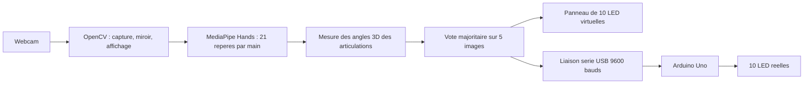

# Reconnaissance des 10 doigts — Projet MP2I

## Qui et quoi

- **Étudiant 1 :** Romain CHEN
- **Étudiant 2 :** Mohammed MOUSSAOUI
- **Enseignante :** E. SABAHI
- **Projet :** un programme Python qui reconnaît, indépendamment, les dix doigts des deux mains filmées par la webcam, affiche leur état sous forme de LED virtuelles, puis envoie les états par le port série à une Arduino qui allume dix LED réelles
- **Dépôt GitHub :** https://github.com/Answy-L/MP2I-Informatique
- **Dernier commit avant rendu :** ⚠️ à compléter au rendu final
- **Changements de sujet :** deux premières pistes explorées restent visibles dans l'historique Git du dépôt : le détecteur de formes BMP en C (séances 1 à 7 du journal de bord), puis la voiture robot commandée par gestes (séances 8 et 9). Le projet actuel, la reconnaissance indépendante des dix doigts avec pilotage de dix LED, a été mise en place à la séance 10.

---

## 1. Présentation

La webcam capture les deux mains en temps réel. MediaPipe détecte les 21 repères de chaque main, le programme mesure l'angle de chaque articulation en 3D pour décider si chaque doigt est tendu ou replié, filtre les détections instables par un vote majoritaire sur cinq images, puis affiche dix LED virtuelles à l'écran. En mode Arduino, les états des dix doigts sont envoyés par le port série à une carte Arduino qui allume dix LED, une par doigt. Un poing fermé est un état neutre : aucun doigt n'est signalé.

Chaque doigt a un identifiant :

| Main | Pouce | Index | Majeur | Annulaire | Auriculaire |
|---|---|---|---|---|---|
| Droite | R1 | R2 | R3 | R4 | R5 |
| Gauche | L1 | L2 | L3 | L4 | L5 |

| Fonctionnalité | Détail |
|---|---|
| Capture vidéo | webcam via OpenCV, image en miroir, 21 repères dessinés par main |
| Détection des mains | MediaPipe Hands, jusqu'à deux mains |
| Reconnaissance | dix doigts indépendants, par mesure d'angles 3D aux articulations |
| Filtrage temporel | vote majoritaire sur les 5 dernières images (un doigt est validé à partir de 3 images) |
| Affichage | panneau de dix LED virtuelles à l'écran, états imprimés quand ils changent |
| Liaison série | trames `R1=1,R2=0,...,L5=0` toutes les 0,10 s si au moins un doigt est levé, 9600 bauds |
| Sécurité | poing fermé = état neutre, aucune trame si aucun doigt n'est levé, trame de remise à zéro à la fermeture |
| Mode démo | sans Arduino branché, le programme tourne quand même (LED virtuelles seules) |



---

## 2. Analyse

### Ce qu'il faut faire

On part d'un flux vidéo et on doit arriver à l'état binaire de chacun des dix doigts, stable et exploitable par l'Arduino. Trois difficultés principales :

- **Reconnaissance** : décider doigt par doigt s'il est tendu ou replié, quelle que soit l'orientation de la main. Un test de hauteur des doigts (comparer les y) échoue dès que la main est penchée ; on mesure donc des angles entre repères, insensibles à l'orientation dans le plan de l'image.
- **Stabilité** : la détection fluctue d'une image à l'autre (main qui bouge, repères instables) ; il faut éviter les clignotements.
- **Côté main** : distinguer la main droite de la main gauche, alors que l'image de la webcam est inversée ; on retourne l'image en miroir avant MediaPipe pour que les côtés soient corrects.

### Contraintes

- La reconnaissance doit rester correcte main penchée : la mesure d'angle utilise les trois coordonnées (x, y, z) des repères, pas seulement les hauteurs.
- Le pouce est le doigt le plus difficile : son articulation reste souvent droite même replié dans le poing. On combine donc un critère d'angle et un critère d'écart entre la pointe du pouce et la base de l'index.
- Un poing fermé doit être un état neutre, pas un état actif : les LED restent éteintes et aucune commande n'est envoyée.
- Environnement : Windows, Python 3.12, webcam de l'ordinateur, une Arduino Uno et dix LED.

### Idée directrice

Un pipeline simple à tester à chaque étape : la webcam seule (mode démo) permet de valider toute la chaîne de reconnaissance sans aucun matériel.

---

## 3. Conception

### Choix techniques

| Élément | Choix | Justification |
|---|---|---|
| Langage | Python 3.12 | déjà installé, bibliothèques de vision faciles à utiliser |
| Vision | OpenCV (capture, affichage) + MediaPipe Hands | repères précis des deux mains en quelques lignes |
| Reconnaissance | angles 3D entre repères consécutifs | reste valable main penchée ou tournée |
| Filtrage | vote majoritaire sur 5 images | supprime le clignotement sans ralentir |
| Liaison | PySerial, USB, 9600 bauds | simple et fiable pour une trame courte toutes les 100 ms |
| Carte | Arduino Uno R3 | dix sorties numériques disponibles pour les LED |

### Découpage en modules

| Fichier | Rôle |
|---|---|
| `hand_tracker_angle.py` | capture, détection des mains, mesure d'angles, reconnaissance des dix doigts, filtrage (classe `FingerSmoother`), panneau de LED virtuelles, liaison série, fermeture propre |
| `.vscode/settings.json` | configuration VS Code : environnement Python système |
| `.vscode/launch.json` | configuration VS Code : lancement et débogage |
| `led_arduino/` (à venir) | sketch Arduino qui reçoit les trames et allume les dix LED |

### Reconnaissance par angles

Pour chaque doigt long (index, majeur, annulaire, auriculaire), on mesure l'angle entre trois repères consécutifs (MCP, PIP, DIP, TIP) par un produit scalaire en 3D :

- articulation PIP ouverte de plus de 155° **et** articulation DIP ouverte de plus de 145° : doigt tendu ;
- sinon : doigt replié.

Pour le pouce, deux critères cumulés :

- angle à l'articulation IP supérieur à 145° ;
- distance entre la pointe du pouce et la base de l'index supérieure à 1,15 fois la distance entre la base du pouce et la base de l'index.

Les seuils sont regroupés en haut du fichier pour être réglables.

### Données et variables principales

| Donnée | Type | Rôle |
|---|---|---|
| `FINGER_IDS` | dictionnaire | identifiants R1 à R5 et L1 à L5 par côté |
| `FINGER_LANDMARKS` | liste | numéros des repères (MCP, PIP, DIP, TIP) de chaque doigt |
| `states` | dictionnaire | état booléen des dix doigts pour l'image courante |
| `FingerSmoother.history` | deque de 5 valeurs | historique de vote par doigt |
| `previous_states` | dictionnaire | états précédents, pour n'imprimer que les changements |

### Protocole série

Format d'une trame : `R1=1,R2=0,...,L5=0` suivi d'un saut de ligne, à 9600 bauds. Les dix identifiants sont toujours présents dans une trame active.

- Python envoie la trame toutes les 0,10 s uniquement si au moins un doigt est levé ;
- poing fermé, main absente ou tous les doigts baissés : aucune trame de doigt ;
- à la fermeture du programme, une trame de remise à zéro est envoyée avant de couper le port ;
- à l'ouverture du port, le programme attend 2 secondes car l'Arduino redémarre souvent à ce moment.

### Matériel

| Élément | Statut |
|---|---|
| Arduino Uno R3 + câble USB A/B | à demander au lycée |
| 10 LED + 10 résistances (220 Ω à 330 Ω) | à demander au lycée |
| Plaque d'essai + fils Dupont | à demander au lycée |
| Webcam | déjà possédée |

Le câblage exact des LED sera documenté avec le sketch Arduino.

---

## 4. Démarche de réalisation

### Journal de bord

**Séance 1 — 06/10/2026 : lancer le dépôt GitHub du binôme.**
Création du dépôt et ajout des premiers fichiers via upload (commit `14dbdda`). C'était la première utilisation de Git à deux, ça a pris un peu de temps. Prochaine étape : mettre en place le README et le `.gitignore`.

**Séance 2 — 13/10/2026 : organiser le dépôt.**
Ajout du README initial et du `.gitignore` (commit `e24dfc1`, poussé le 12/10) en suivant le guide GitHub, VS Code et WSL. Prochaine étape : étudier le format BMP en détail.

**Séance 3 — 20/10/2026 : analyser le format BMP.**
Étude du format BMP 24 bits sur papier et avec de la documentation : en-tête de 54 octets, nombres stockés en petit-boutiste, lignes arrondies à un multiple de 4 octets, pixels dans l'ordre bleu, vert, rouge, lignes stockées de bas en haut. On a eu du mal au début avec le petit-boutisme et le padding. Prochaine étape : concevoir le programme.

**Séance 4 — 27/10/2026 : concevoir le programme.**
Sur papier : structure `Image` (largeur, hauteur, tableau de niveaux de gris), découpage du projet en jalons (lecture BMP, puis binarisation et comptage, puis détection de formes) et liste des cas de tests. Prochaine étape : rédiger le README complet.

**Séance 5 — 01/11/2026 : rédiger le README du projet.**
Rédaction du README complet à partir des notes : identification, analyse, conception et plan de tests (commit `3975cd1`). Puis l'identification du binôme a été complétée (`df0d392`) et le texte a été entièrement reformulé et relu par les deux élèves (`cb92181`). Prochaine étape : poser le squelette du jalon 1.

**Séance 6 — 02/11/2026 : jalon 1, poser le squelette du code (piste C).**
Commit `b52bdcf` : `bmp.h` complet, `bmp.c` en squelette guidé, `main.c` de test, `Makefile` avec gcc, et `tests/generer_image.py`. Problème : gcc n'était pas disponible sur l'ordinateur de travail. Prochaine étape : écrire `lire_bmp`.

**Séance 7 — 03/11/2026 : jalon 1, écrire `lire_bmp` (piste C).**
Un membre du binôme a écrit la fonction, l'autre l'a relue. Vérification sur 3 cas : lecture correcte d'une image générée, placement correct d'un carré avec padding, et rejet propre des fichiers invalides. La piste C s'arrête ensuite là : le changement de sujet est validé le même jour.

**Séance 8 — 03/11/2026 : premier changement de sujet.**
On a appris que le projet de base en Python était possible : un programme qui traque la main à la webcam, reconnaît des gestes, puis commande une carte Arduino qui actionne des moteurs. Le changement a été validé par l'enseignante. La première piste C reste dans l'historique Git du dépôt.

**Séance 9 — 09/11/2026 : programme complet de la piste robot.**
Écriture de `hand_robot.py` : capture OpenCV, repères MediaPipe, reconnaissance de cinq gestes, filtrage sur 5 images, liaison série avec heartbeat. Programmes Arduino de commande des moteurs et de test, tests automatiques de la logique de reconnaissance, cahier des charges dans `docs/`, retrait des fichiers C du dépôt.

**Séance 10 — 15/11/2026 : deuxième changement de sujet, reconnaissance des dix doigts.**
Le projet évolue : on abandonne la voiture robot au profit de la reconnaissance indépendante des dix doigts des deux mains, avec pilotage de dix LED. Nouveau programme `hand_tracker_angle.py` : la reconnaissance passe de comparaisons de distances (cinq gestes, une main) à une mesure d'angles par articulation en 3D (dix doigts, deux mains), avec un panneau de dix LED virtuelles, un vote majoritaire sur cinq images contre le clignotement, un état neutre pour le poing fermé et des trames série par doigt. Le dépôt est restructuré : les fichiers de la piste robot sont retirés (l'historique Git les conserve), la configuration VS Code est ajoutée. Prochaine étape : écrire le sketch Arduino des dix LED, puis tester avec le matériel.

### Jalons et avancement

1. Programme Python de reconnaissance des dix doigts (angles, filtrage, LED virtuelles) — **fait (séance 10)**.
2. Liaison série par doigt vers l'Arduino — **faite (séance 10)**.
3. Sketch Arduino des dix LED (`led_arduino/`) — à faire.
4. Campagne de tests matériels avec les dix LED (section 6) — à faire.
5. Réglages sur le matériel réel (seuils d'angles, port COM) et bilan final — à faire.

### Problèmes rencontrés et solutions

| Problème | Solution | Séance(s) |
|---|---|---|
| Un test de hauteur des doigts échoue dès que la main est penchée | Mesure d'angles 3D entre repères consécutifs, insensible à l'orientation | Séance 10 |
| Le pouce replié garde souvent son articulation droite | Double critère pour le pouce : angle à l'articulation IP et écart pointe du pouce / base de l'index | Séance 10 |
| État d'un doigt qui clignote d'une image à l'autre | Vote majoritaire sur les 5 dernières images, validation à partir de 3 images | Séance 10 |
| Côté gauche/droite inversé par la webcam | Image retournée en miroir avant le traitement MediaPipe | Séance 10 |
| L'Arduino redémarre à l'ouverture du port série | Attente de 2 secondes après l'ouverture | Séance 10 |
| Une main qui disparaît laisse un état figé | Historique de filtrage effacé dès qu'une main n'est plus détectée | Séance 10 |

### Reste à faire avant le rendu

- Écrire et ajouter le sketch Arduino des dix LED (`led_arduino/`), avec le câblage des LED.
- Suivre la procédure de test complète (section 6) et consigner les résultats réels dans le tableau de jeux d'essais.
- Régler sur le vrai matériel : port COM, éventuellement les seuils d'angles.
- Remplir la répartition effective du travail et les bilans individuels.
- Compléter la date du dernier commit.

---

## 5. Installation et utilisation

**Prérequis :** Windows, Python 3.12, une webcam ; une Arduino Uno et dix LED pour le mode Arduino.

```bash
py -3.12 -m pip install opencv-python mediapipe pyserial
```

En cas d'échec de l'installation, créer un environnement virtuel plutôt que d'essayer des versions au hasard :

```bash
py -3.12 -m venv .venv
.venv/Scripts/activate
python -m pip install --upgrade pip
pip install opencv-python mediapipe pyserial
```

Deux modes, choisis en haut de `hand_tracker_angle.py` :

- `MODE = "demo"` : LED virtuelles à l'écran, aucun Arduino nécessaire ;
- `MODE = "arduino"` : envoi série vers l'Arduino (adapter `SERIAL_PORT` dans le Gestionnaire de périphériques, section Ports (COM et LPT)).

Lancement :

```bash
py -3.12 hand_tracker_angle.py
```

Quitter avec `q` ou Échap : le programme envoie une trame de remise à zéro puis ferme la caméra et le port série. Le dossier `.vscode/` contient la configuration VS Code (environnement Python système) utilisée pendant le développement.

---

## 6. Tests

### Procédure matérielle progressive

1. Mode démo, sans Arduino : la fenêtre vidéo s'ouvre, le panneau de LED virtuelles s'affiche.
2. Les 21 repères s'affichent sur chaque main détectée, avec son côté écrit près du poignet.
3. Lever chaque doigt d'une main : la LED virtuelle correspondante s'allume ; replier le doigt : elle s'éteint.
4. Deux mains visibles : les dix LED virtuelles sont indépendantes.
5. Poing fermé : message « poing fermé, aucun signal », toutes les LED restent éteintes.
6. Main retirée : l'historique de filtrage est effacé, les LED de cette main s'éteignent.
7. Mode Arduino, LED branchées : chaque doigt levé allume la LED réelle correspondante.
8. Fermer le programme avec `q` : toutes les LED s'éteignent (trame de remise à zéro).

### Jeux d'essais

| # | Catégorie | Entrée | Résultat attendu | Résultat obtenu |
|---|---|---|---|---|
| 1 | Normal | index de la main droite levé | R2 allumé, les autres éteints | ⚠️ |
| 2 | Normal | les cinq doigts de la main droite levés | R1 à R5 allumés | ⚠️ |
| 3 | Normal | un doigt de chaque main levé | une LED par main allumée | ⚠️ |
| 4 | Normal | les dix doigts levés (deux mains ouvertes) | les dix LED allumées | ⚠️ |
| 5 | Cas limite | poing fermé d'une main, l'autre ouverte | état neutre pour le poing, LED de l'autre main actives | ⚠️ |
| 6 | Cas limite | main penchée d'environ 45° | les mêmes doigts sont reconnus | ⚠️ |
| 7 | Cas limite | main retirée de l'image | LED de cette main éteintes en moins d'une seconde | ⚠️ |
| 8 | Cas limite | main en lumière faible ou vue de profil | détection dégradée documentée | ⚠️ |
| 9 | Sécurité | fermeture du programme avec q | toutes les LED réelles s'éteignent | ⚠️ |
| 10 | Sécurité | port COM débranché puis rebranché | programme ferme proprement ou reprend sans faux états | ⚠️ |
| 11 | Filtrage | lever/abaisser un doigt rapidement | pas de clignotement grâce au vote majoritaire | ⚠️ |
| 12 | Robustesse | session de 5 minutes avec gestes variés | pas de plantage, états corrects | ⚠️ |

### Dépannage

| Symptôme | Cause probable | Vérification | Correction |
|---|---|---|---|
| La fenêtre vidéo ne s'ouvre pas | webcam occupée ou `CAMERA_INDEX` erroné | fermer Zoom/Teams, essayer `CAMERA_INDEX = 1` | libérer la webcam, changer l'index |
| Les repères n'apparaissent pas | lumière insuffisante, main trop loin | main à 30-60 cm, lumière frontale | améliorer l'éclairage |
| Le port COM ne s'ouvre pas | mauvais port ou moniteur série ouvert | Gestionnaire de périphériques, IDE Arduino | bon port, fermer le moniteur série |
| Un doigt clignote à l'écran | filtrage trop court | `SMOOTHING_FRAMES = 5` | augmenter à 7-10 |
| Le pouce est mal reconnu | seuils inadaptés à la main | afficher les angles | ajuster les seuils en haut du fichier |
| Le côté gauche/droite est inversé | image non retournée ou webcam différente | `MIRROR_IMAGE = True` | ajuster selon la caméra |

---

## 7. Bilan

### Limites connues

- La reconnaissance par angles suppose que les repères 3D de MediaPipe sont fiables : vue de profil ou en lumière faible, la détection des repères elle-même se dégrade.
- Le pouce reste le doigt le plus délicat : le double critère (angle et écart) réduit les erreurs, mais un réglage sur de vraies mains sera peut-être nécessaire.
- Les seuils d'angles (155°, 145°, 1,15) ont été choisis pour des mains typiques ; des mains très différentes peuvent demander un ajustement.
- Le sketch Arduino des dix LED n'est pas encore dans le dépôt : la partie matérielle reste à faire.

### Améliorations possibles

- Mode de calibration des seuils d'angles.
- Retour d'état de l'Arduino vers Python (LED allumée confirmée).
- Remplacer les LED par des actionneurs commandés doigt par doigt.
- Statistiques de fiabilité par doigt pendant une session.

### Répartition effective du travail

⚠️ Obligatoire : remplir avec ce qui s'est réellement passé dans les commits, pas avec ce qui était prévu.

| Tâche / fonctionnalité | Responsable principal | Contribution de l'autre membre | Fichiers ou commits Git associés |
|---|---|---|---|
| Analyse du problème et conception | ⚠️ | ⚠️ | ⚠️ |
| Programme Python (reconnaissance des dix doigts, LED virtuelles, liaison série) | ⚠️ | ⚠️ | ⚠️ |
| Sketch Arduino des dix LED | ⚠️ | ⚠️ | ⚠️ |
| Configuration VS Code | ⚠️ | ⚠️ | ⚠️ |
| Tests matériels | ⚠️ | ⚠️ | ⚠️ |
| Rédaction et relecture du README | ⚠️ | ⚠️ | ⚠️ |

### Bilans individuels

**Romain CHEN — étudiant 1 :** ⚠️ à rédiger au moment du rendu : ce que vous avez fait, les difficultés, comment vous les avez réglées, ce que vous avez appris (quelques lignes).

**Mohammed MOUSSAOUI — étudiant 2 :** ⚠️ à rédiger au moment du rendu : ce que vous avez fait, les difficultés, comment vous les avez réglées, ce que vous avez appris (quelques lignes).

---

*Projet MP2I — Informatique, E. SABAHI*
