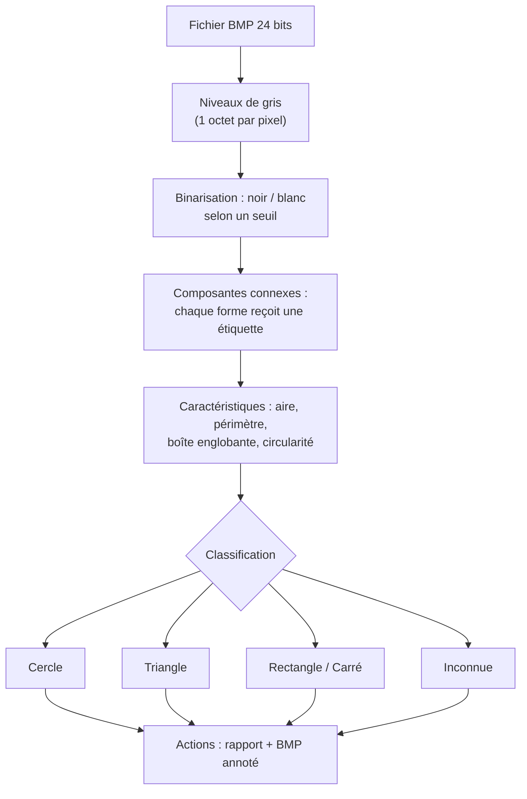

# Détecteur de formes géométriques dans des images — Projet libre MP2I

## Identification du binôme et du projet

- **Étudiant(e) 1 — Prénom NOM :** Romain CHEN
- **Étudiant(e) 2 — Prénom NOM :** Mohammed MOUSSAOUI
- **Projet choisi :** Projet libre validé par l'enseignante — *Détecteur de formes géométriques dans des images BMP, en C, sans bibliothèque externe*
- **Lien du dépôt GitHub :** https://github.com/Answy-L/MP2I-Informatique
- **Date du dernier commit avant rendu :** ⚠️ à compléter au rendu final (8 novembre 2026)

⚠️ Important : obtenez la confirmation écrite de l'enseignante sur le sujet libre (mail ou message) et citez-la ici.

---

## 1. Présentation

Ce programme, écrit **en C, sans bibliothèque externe** (aucun OpenCV), reconnaît des **formes géométriques** (cercle, triangle, rectangle, carré) présentes dans une image, et déclenche une **action** pour chaque forme reconnue.

L'image est un fichier **BMP 24 bits** — le seul format d'image dont la structure est assez simple pour être décodée « à la main » en C : un en-tête de 54 octets suivi des pixels bruts. Les images analysées peuvent être créées avec Paint, ou extraites d'une webcam et converties en BMP.

Fonctionnalités :

| Fonctionnalité | Détail |
|---|---|
| Charger une image BMP | Décodage de l'en-tête + pixels, gestion du padding des lignes |
| Binarisation | Conversion en niveaux de gris puis noir/blanc par seuil (fixe ou automatique) |
| Détection des formes | Étiquetage par composantes connexes (parcours en largeur avec une pile dynamique) |
| Caractéristiques | Aire, périmètre, boîte englobante, remplissage, circularité |
| Classification | Cercle / triangle / rectangle / carré / forme inconnue |
| Actions | Rapport détaillé + image BMP « annotée » : chaque forme est colorée selon sa classe |
| Interface CLI | Menu : charger, régler le seuil, analyser, exporter, aide, quitter |

---

## 2. Analyse

### Besoins

Partir d'un fichier binaire quelconque (le BMP) et aboutir à une **liste de formes identifiées**, sans bibliothèque d'image : toutes les étapes intermédiaires (décodage, seuillage, parcours) doivent donc être écrites à la main. Chaque forme reconnue doit déclencher une action — au minimum un rapport et une image annotée.

### Contraintes

- **Aucune bibliothèque externe** : le décodage BMP, la binarisation et le parcours doivent être écrits en C standard.
- La taille de l'image est **inconnue à l'avance** : toutes les structures (pixels, étiquettes, pile de parcours, liste de formes) sont allouées dynamiquement.
- Une image peut contenir **un nombre quelconque de formes** de tailles variées.
- Le parcours de formes doit être **itératif** (pile dynamique) : un parcours récursif par flood fill fait exploser la pile d'appels sur les grandes images — choix à justifier en conception.
- Le programme doit rejeter proprement un fichier non-BMP, tronqué, ou une image aux dimensions incohérentes.
- Toute la mémoire allouée doit être libérée (vérification `valgrind` exigée dans les tests).

### Idée directrice : le pipeline

Chaque étape transforme les données de l'étape précédente, et chacune se teste séparément :



---

## 3. Conception

### Découpage en modules

| Fichier | Rôle |
|---|---|
| `bmp.h` / `bmp.c` | Structure `Image`, lecture et écriture BMP 24 bits, conversions gris ↔ RGB, libération |
| `analyse.h` / `analyse.c` | Binarisation, étiquetage par composantes connexes (pile dynamique), caractéristiques |
| `formes.h` / `formes.c` | Structure `Forme`, classification par heuristiques, liste de formes |
| `actions.h` / `actions.c` | Rapport console + génération du BMP annoté (une couleur par classe) |
| `main.c` | Menu, enchaînement des étapes, libération finale |
| `Makefile` | `make`, `make clean` |

### Structures de données

```c
/* Image en niveaux de gris (ou binaire : 0 = noir, 255 = blanc) */
typedef struct {
    int largeur, hauteur;
    unsigned char *pixels;    /* tableau largeur × hauteur, alloué dynamiquement */
} Image;

/* Une forme détectée */
typedef struct {
    int aire;                 /* nombre de pixels */
    int perimetre;            /* pixels de contour */
    int xmin, xmax, ymin, ymax; /* boîte englobante */
    double circularite;       /* 4·π·aire / périmètre²  (≈ 1 pour un cercle) */
    double remplissage;       /* aire / aire de la boîte englobante */
    ClasseForme classe;       /* CERCLE, TRIANGLE, RECTANGLE, CARRE, INCONNUE */
} Forme;
```

### Décodage BMP (le point délicat n°1)

```text
lire_bmp(nomFichier) :
    ouvrir le fichier en lecture binaire ("rb")
    vérifier la signature "BM" (2 premiers octets)     # sinon : erreur, pas un BMP
    lire la position des pixels (offset) et les dimensions (largeur, hauteur)
    si largeur ≤ 0 ou hauteur ≤ 0 : erreur
    allouer pixels (largeur × hauteur)
    pour chaque ligne y :
        lire largeur × 3 octets (B, G, R)
        gris ← (R + V + B) / 3        # formule simple, à citer comme choix
        stocker pixels[y][x] ← gris
        sauter le padding             # chaque ligne BMP est multiple de 4 octets !
    fermer le fichier
```

### Composantes connexes (le point délicat n°2)

```text
etiqueter(image) :
    etiquettes ← tableau largeur × hauteur initialisé à 0
    pour chaque pixel (x, y) noir et non étiqueté :
        id ← id + 1
        empiler (x, y) ; étiqueter id
        tant que la pile n'est pas vide :
            (px, py) ← dépiler
            pour chaque voisin (4-connexité) :
                si dans l'image, noir, non étiqueté :
                    étiqueter id ; empiler
    # pendant le parcours : cumuler aire, périmètre, boîte englobante
```

⚠️ Choix à justifier dans le bilan : parcours **itératif avec pile dynamique** (`malloc`/`realloc`) plutôt que récursif, car un flood fill récursif provoque un débordement de pile système sur les grandes formes (limite typique : ≈ 1 Mo de pile d'appels).

### Classification (heuristiques)

| Mesure | Cercle | Carré | Rectangle | Triangle |
|---|---|---|---|---|
| circularité 4πA/P² | ≈ 1 | ≈ 0,79 | ≈ 0,79 | ≈ 0,6 |
| remplissage A / (L×H) | ≈ 0,785 | ≈ 1 | ≈ 1 | ≈ 0,5 |

```text
classer(f) :
    si f.circularite > 0,9                    → CERCLE
    sinon si f.remplissage > 0,9 :
        si largeur ≈ hauteur                  → CARRE
        sinon                                 → RECTANGLE
    sinon si f.remplissage entre 0,4 et 0,6    → TRIANGLE
    sinon                                     → INCONNUE
```

⚠️ Ces seuils sont des **hypothèses de départ** : ils devront être affinés sur les images de test — c'est justement le genre de décision à raconter dans la section « Démarche ».

### BMP annoté (l'action principale)

Copie de l'image d'origine où les pixels de chaque forme prennent une couleur par classe (cercle → rouge, triangle → vert, rectangle → bleu, carré → jaune). L'écriture BMP réutilise `bmp.c` : en-tête identique + pixels (attention au padding à l'écriture aussi).

---

## 4. Démarche de réalisation

⚠️ À rédiger au fil du projet, en citant les commits. Plan de jalons proposé :

1. **Jalon 1** : `bmp.c` — lecture, affichage des dimensions, libération ; test sur une image Paint. Vérification `valgrind` immédiate.
2. **Jalon 2** : binarisation + premier affichage du comptage de pixels noirs (testable sans détection).
3. **Jalon 3** : étiquetage par composantes connexes avec la pile dynamique ; test sur une image à 3 formes → 3 étiquettes.
4. **Jalon 4** : caractéristiques + classification ; premiers seuils ajustés sur les images de test.
5. **Jalon 5** : BMP annoté + rapport.
6. **Jalon 6** : erreurs (fichier non-BMP, tronqué), cas limites, `valgrind` complet, README final.

Problèmes rencontrés et solutions adoptées :

| Problème | Solution | Commit(s) |
|---|---|---|---|
| ⚠️ À COMPLÉTER (ex : « image affichée en miroir » → « les lignes BMP sont stockées de bas en haut ») | ⚠️ | ⚠️ |

---

## 5. Compilation et utilisation

**Prérequis :** `gcc` ou `clang`, `make`, `valgrind` (recommandé). Aucune bibliothèque externe.

```bash
make                 # construit l'exécutable
./formes             # lance le programme (⚠️ adapter au nom choisi)
make clean           # nettoie les .o
```

Exemple de session attendue :

```text
$ ./formes
> charger tests/formes01.bmp
Image chargée : 640 × 480 px
> seuil 128
> analyser
4 forme(s) détectée(s) :
  #1  classe=CERCLE     aire=3185 px  boîte=(102,80)-(182,160)  circularité=0,98
  #2  classe=CARRE     aire=4096 px  boîte=(300,50)-(364,114)  circularité=0,79
  #3  classe=TRIANGLE  aire=2043 px  boîte=(450,90)-(518,158)  circularité=0,60
  #4  classe=RECTANGLE aire=5040 px  boîte=(150,300)-(310,360) circularité=0,76
> exporter sortie.bmp
Image annotée écrite : sortie.bmp
> quitter
```

⚠️ À COMPLÉTER : faire correspondre ces exemples aux sorties réelles.

Vérification mémoire avant rendu :

```bash
valgrind --leak-check=full ./formes
# attendu : « All heap blocks were freed — no leaks are possible »
```

---

## 6. Tests

### Images de test (dossier `tests/`)

⚠️ À COMPLÉTER : fournir 4 à 6 images BMP créées avec Paint (formes sur fond blanc) : image simple, image multi-formes, formes de tailles très différentes, forme collée au bord, image vide (tout blanc), image bruitée.

### Jeux d'essais

| # | Catégorie | Entrée | Résultat attendu | Résultat obtenu |
|---|---|---|---|---|
| 1 | Normal | image avec 1 cercle | 1 forme, classe CERCLE | ⚠️ |
| 2 | Normal | image avec cercle + carré + triangle | 3 formes bien classées | ⚠️ |
| 3 | Normal | carré vs rectangle proches | classes distinctes | ⚠️ |
| 4 | Cas limite | forme collée au bord de l'image | détectée quand même | ⚠️ |
| 5 | Cas limite | forme de 1-2 pixels (grain de bruit) | ignorée si sous un seuil d'aire minimale (⚠️ préciser votre choix) | ⚠️ |
| 6 | Cas limite | image tout blanc | 0 forme, pas de crash | ⚠️ |
| 7 | Cas limite | image tout noir | 1 seule grande forme (ou erreur propre si aire > image) | ⚠️ |
| 8 | Erreur | fichier texte renommé `.bmp` | « signature invalide », pas de crash | ⚠️ |
| 9 | Erreur | fichier BMP tronqué (coupé) | erreur de lecture, mémoire libérée | ⚠️ |
| 10 | Erreur | nom de fichier inexistant | message d'erreur, pas de crash | ⚠️ |
| 11 | Mémoire | session complète sous `valgrind` | 0 octet perdu | ⚠️ |
| 12 | Robustesse | même image analysée 2 fois de suite | mêmes résultats, pas de fuite | ⚠️ |

---

## 7. Bilan

### Limites actuelles

⚠️ À COMPLÉTER (exemples probables : uniquement BMP 24 bits ; classification heuristique qui échoue sur formes concaves ; sensibilité au bruit de l'image réelle ; les formes qui se touchent ne forment qu'une seule composante).

### Améliorations possibles

⚠️ À COMPLÉTER (exemples : seuillage automatique d'Otsu ; détection de contours pour le périmètre ; reconnaissance de formes plus complexes ; lecture d'autres formats ; images issues directement de la webcam).

### Répartition effective du travail

⚠️ Obligatoire : remplir avec la réalité des commits, pas la prévision.

| Tâche / fonctionnalité | Responsable principal (Prénom NOM) | Contribution de l'autre membre | Fichiers ou commits Git associés |
|---|---|---|---|
| Analyse du problème et conception | ⚠️ | ⚠️ | ⚠️ |
| Décodage BMP (`bmp.c/h`) | ⚠️ | ⚠️ | ⚠️ |
| Composantes connexes et caractéristiques (`analyse.c/h`) | ⚠️ | ⚠️ | ⚠️ |
| Classification (`formes.c/h`) | ⚠️ | ⚠️ | ⚠️ |
| Actions et image annotée (`actions.c/h`) | ⚠️ | ⚠️ | ⚠️ |
| Gestion des erreurs et de la mémoire | ⚠️ | ⚠️ | ⚠️ |
| Tests et validation | ⚠️ | ⚠️ | ⚠️ |
| Rédaction et relecture du README | ⚠️ | ⚠️ | ⚠️ |

### Bilans individuels

**Romain CHEN — étudiant 1 :** ⚠️ à rédiger au moment du rendu : tâches réalisées, difficultés rencontrées, solutions apportées, apprentissages. (quelques lignes)

**Mohammed MOUSSAOUI — étudiant 2 :** ⚠️ à rédiger au moment du rendu : tâches réalisées, difficultés rencontrées, solutions apportées, apprentissages. (quelques lignes)

---

*Projet libre MP2I — Informatique, E. SABAHI — Rendu le 8 novembre 2026 au plus tard.*