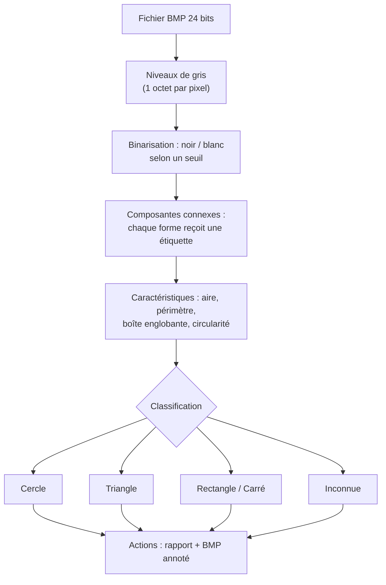

# Détecteur de formes géométriques dans des images — Projet libre MP2I

## Qui et quoi

- **Étudiant(e) 1 :** Romain CHEN
- **Étudiant(e) 2 :** Mohammed MOUSSAOUI
- **Projet :** projet libre validé par l'enseignante, un détecteur de formes géométriques dans des images BMP, en C, sans bibliothèque externe
- **Dépôt GitHub :** https://github.com/Answy-L/MP2I-Informatique
- **Dernier commit avant rendu :** ⚠️ à compléter au rendu final (8 novembre 2026)

⚠️ À ne pas oublier : récupérer la confirmation écrite de l'enseignante sur le sujet libre (mail ou message) et la citer ici.

---

## 1. Présentation

Le programme est écrit **en C, sans aucune bibliothèque externe** (pas d'OpenCV). Il repère des **formes géométriques** (cercle, triangle, rectangle, carré) dans une image et lance une **action** pour chaque forme reconnue.

On travaille sur des fichiers **BMP 24 bits**. C'est le seul format d'image assez simple pour être décodé à la main en C : un en-tête de 54 octets, puis les pixels bruts. Les images peuvent venir de Paint, ou d'une webcam puis être converties en BMP.

| Fonctionnalité | Détail |
|---|---|
| Charger une image BMP | Lecture de l'en-tête et des pixels, avec gestion du padding des lignes |
| Binarisation | Passage en niveaux de gris, puis en noir et blanc grâce à un seuil (fixe ou automatique) |
| Détection des formes | Étiquetage par composantes connexes, parcours en largeur avec une pile dynamique |
| Caractéristiques | Aire, périmètre, boîte englobante, remplissage, circularité |
| Classification | Cercle, triangle, rectangle, carré ou forme inconnue |
| Actions | Rapport détaillé et image BMP « annotée » où chaque forme est colorée selon sa classe |
| Interface en ligne de commande | Menu : charger, régler le seuil, analyser, exporter, aide, quitter |

---

## 2. Analyse

### Ce qu'il faut faire

On part d'un fichier binaire brut (le BMP) et on veut arriver à une **liste de formes identifiées**. Sans bibliothèque d'image, toutes les étapes intermédiaires (décodage, seuillage, parcours) sont à écrire nous-mêmes. Chaque forme reconnue doit déclencher une action, au minimum un rapport et une image annotée.

### Contraintes

- **Aucune bibliothèque externe** : décodage BMP, binarisation et parcours se font en C standard.
- On ne connaît pas la taille de l'image à l'avance, donc tout (pixels, étiquettes, pile de parcours, liste de formes) est alloué dynamiquement.
- Une image peut contenir autant de formes qu'on veut, de tailles très différentes.
- Le parcours doit être **itératif** (pile dynamique). Un flood fill récursif fait exploser la pile d'appels sur les grandes images, et ce choix sera à justifier dans la conception.
- Le programme doit refuser proprement un fichier qui n'est pas un BMP, un fichier tronqué ou une image aux dimensions incohérentes.
- Toute la mémoire allouée doit être libérée, et les tests doivent le prouver avec `valgrind`.

### Idée directrice : le pipeline

Chaque étape reprend le résultat de la précédente, et on peut les tester une par une :



---

## 3. Conception

### Découpage en modules

| Fichier | Rôle |
|---|---|
| `bmp.h` / `bmp.c` | Structure `Image`, lecture et écriture BMP 24 bits, conversions gris ↔ RGB, libération |
| `analyse.h` / `analyse.c` | Binarisation, étiquetage par composantes connexes (pile dynamique), caractéristiques |
| `formes.h` / `formes.c` | Structure `Forme`, classification par heuristiques, liste de formes |
| `actions.h` / `actions.c` | Rapport dans la console et génération du BMP annoté (une couleur par classe) |
| `main.c` | Menu, enchaînement des étapes, libération finale |
| `Makefile` | `make`, `make clean` |

### Structures de données

```c
/* Image en niveaux de gris (ou binaire : 0 = noir, 255 = blanc) */
typedef struct {
    int largeur, hauteur;
    unsigned char *pixels;    /* tableau largeur × hauteur, alloué dynamiquement */
} Image;

/* Une forme détectée */
typedef struct {
    int aire;                 /* nombre de pixels */
    int perimetre;            /* pixels de contour */
    int xmin, xmax, ymin, ymax; /* boîte englobante */
    double circularite;       /* 4·π·aire / périmètre²  (≈ 1 pour un cercle) */
    double remplissage;       /* aire / aire de la boîte englobante */
    ClasseForme classe;       /* CERCLE, TRIANGLE, RECTANGLE, CARRE, INCONNUE */
} Forme;
```

### Décodage BMP (premier point délicat)

```text
lire_bmp(nomFichier) :
    ouvrir le fichier en lecture binaire ("rb")
    vérifier la signature "BM" (2 premiers octets)     # sinon : erreur, pas un BMP
    lire la position des pixels (offset) et les dimensions (largeur, hauteur)
    si largeur ≤ 0 ou hauteur ≤ 0 : erreur
    allouer pixels (largeur × hauteur)
    pour chaque ligne y :
        lire largeur × 3 octets (B, G, R)
        gris ← (R + V + B) / 3        # formule simple, à citer comme choix
        stocker pixels[y][x] ← gris
        sauter le padding             # chaque ligne BMP est multiple de 4 octets !
    fermer le fichier
```

### Composantes connexes (second point délicat)

```text
etiqueter(image) :
    etiquettes ← tableau largeur × hauteur initialisé à 0
    pour chaque pixel (x, y) noir et non étiqueté :
        id ← id + 1
        empiler (x, y) ; étiqueter id
        tant que la pile n'est pas vide :
            (px, py) ← dépiler
            pour chaque voisin (4-connexité) :
                si dans l'image, noir, non étiqueté :
                    étiqueter id ; empiler
    # pendant le parcours : cumuler aire, périmètre, boîte englobante
```

⚠️ Choix à justifier dans le bilan : parcours **itératif avec pile dynamique** (`malloc`/`realloc`) plutôt que récursif, parce qu'un flood fill récursif fait déborder la pile système sur les grandes formes (la limite tourne autour de 1 Mo de pile d'appels).

### Classification (heuristiques)

| Mesure | Cercle | Carré | Rectangle | Triangle |
|---|---|---|---|---|
| circularité $4\pi A/P^2$ | ≈ 1 | ≈ 0,79 | ≈ 0,79 | ≈ 0,6 |
| remplissage $A/(L \times H)$ | ≈ 0,785 | ≈ 1 | ≈ 1 | ≈ 0,5 |

```text
classer(f) :
    si f.circularite > 0,9                    → CERCLE
    sinon si f.remplissage > 0,9 :
        si largeur ≈ hauteur                  → CARRE
        sinon                                 → RECTANGLE
    sinon si f.remplissage entre 0,4 et 0,6    → TRIANGLE
    sinon                                     → INCONNUE
```

⚠️ Ces seuils ne sont que des **hypothèses de départ**. Il faudra les ajuster sur les images de test, et c'est exactement le genre de choix à raconter dans la section « Démarche ».

### BMP annoté (l'action principale)

C'est une copie de l'image d'origine où les pixels de chaque forme prennent la couleur de leur classe : cercle en rouge, triangle en vert, rectangle en bleu, carré en jaune. L'écriture réutilise `bmp.c` : même en-tête, puis les pixels. Attention au padding à l'écriture aussi.

---

## 4. Démarche de réalisation

### Journal de bord

**Séance 1 — 06/10/2026 : lancer le dépôt GitHub du binôme.**
Création du dépôt et ajout des premiers fichiers via upload (commit `14dbdda`). C'était la première utilisation de Git à deux, ça a pris un peu de temps. Prochaine étape : mettre en place le README et le `.gitignore`.

**Séance 2 — 13/10/2026 : organiser le dépôt.**
Ajout du README initial et du `.gitignore` (commit `e24dfc1`, poussé le 12/10) en suivant le guide GitHub, VS Code et WSL. L'enseignante a validé le sujet à l'oral : détecteur de formes dans les images BMP en C pur (la confirmation écrite n'est pas encore obtenue). Prochaine étape : étudier le format BMP en détail.

**Séance 3 — 20/10/2026 : analyser le format BMP.**
Étude du format BMP 24 bits sur papier et avec de la documentation : en-tête de 54 octets, nombres stockés en petit-boutiste, lignes arrondies à un multiple de 4 octets, pixels dans l'ordre bleu, vert, rouge, lignes stockées de bas en haut. On a eu du mal au début avec le petit-boutisme et le padding. Prochaine étape : concevoir le programme.

**Séance 4 — 27/10/2026 : concevoir le programme.**
Sur papier : structure `Image` (largeur, hauteur, tableau de niveaux de gris), découpage du projet en jalons (lecture BMP, puis binarisation et comptage, puis détection de formes) et liste des 12 cas de tests. Le brouillon du squelette de `bmp.c` a aussi été commencé. Le plus dur a été de décider comment gérer les erreurs de `fopen` et `malloc`. Prochaine étape : rédiger le README complet.

**Séance 5 — 01/11/2026 : rédiger le README du projet.**
Rédaction du README complet à partir des notes : identification, analyse, conception et plan de tests (commit `3975cd1`). Puis l'identification du binôme a été complétée (`df0d392`) et le texte a été entièrement reformulé et relu par les deux élèves (`cb92181`). On a veillé à ce que le texte soit vraiment de nous. Prochaine étape : poser le squelette du jalon 1.

**Séance 6 — 02/11/2026 : jalon 1, poser le squelette du code.**
Commit `b52bdcf` : `bmp.h` complet, `bmp.c` en squelette guidé avec `liberer_image` déjà donnée, `main.c` qui teste le chargement (attendu : 64 x 48 px et 496 pixels noirs), `Makefile` avec gcc, et `tests/generer_image.py` qui génère `formes01.bmp`. Problème : gcc n'est pas disponible sur l'ordinateur de travail, impossible de compiler tout de suite. Prochaine étape : écrire `lire_bmp`.

**Séance 7 — 03/11/2026 : jalon 1, écrire `lire_bmp`.**
Un membre du binôme a écrit la fonction, l'autre l'a relue. Elle a été vérifiée sur 3 cas : `formes01.bmp` doit donner 64 x 48 et 496 noirs ; une image de 65 x 20 avec padding place bien le carré au bon endroit ; et les fichiers invalides (mauvaise signature, fichier tronqué, fichier inexistant) renvoient `NULL` proprement. Reste à compiler en local. Deux points à surveiller, traités : `entete[21] << 24` peut être un comportement indéfini sur un `int` signé (corrigé : les décalages se font sur `unsigned` avant d'être convertis en `int`), et la hauteur négative n'est pas gérée (documentée comme limite).

### Jalons prévus et avancement

1. **Jalon 1** : `bmp.c` avec lecture, affichage des dimensions et libération — **code écrit et relu (séance 7), compilation locale en cours**.
2. **Jalon 2** : binarisation, puis affichage du nombre de pixels noirs (testable sans détection) — à faire.
3. **Jalon 3** : étiquetage par composantes connexes avec la pile dynamique. Test sur une image à 3 formes, on doit trouver 3 étiquettes — à faire.
4. **Jalon 4** : caractéristiques et classification, premiers réglages des seuils sur les images de test — à faire.
5. **Jalon 5** : BMP annoté et rapport — à faire.
6. **Jalon 6** : gestion des erreurs (fichier non-BMP, tronqué), cas limites, `valgrind` complet, README final — à faire.

### Problèmes rencontrés et solutions

| Problème | Solution | Séance(s) / commit(s) |
|---|---|---|
| Nombres de l'en-tête incompréhensibles au début | Étude du petit-boutisme : octet de poids faible en premier ; reconstruction des entiers octet par octet | Séance 3, commit du jalon 1 |
| Pixels décalés sur une image de largeur impaire | Chaque ligne BMP est arrondie à un multiple de 4 octets : on saute le padding après chaque ligne | Séance 3, commit du jalon 1 |
| `entete[21] << 24` : comportement indéfini possible sur un `int` signé | Les décalages se font sur `unsigned`, puis conversion en `int` | Séance 7, commit du jalon 1 |
| BMP à hauteur négative (lignes déjà de haut en bas) non géré | Choix documenté comme limite : les dimensions invalides sont refusées proprement | Séance 7 |
| gcc indisponible sur l'ordinateur de travail | Code écrit, relu et vérifié sur papier d'abord ; compilation locale prévue avant la suite | Séance 6 |

### Reste à faire avant le rendu du 8 novembre

- Compiler le jalon 1 en local (`python tests/generer_image.py`, `make`, `./formes` : doit afficher 64 x 48 et 496).
- Commiter `bmp.c` complet.
- Jalon 2 : binarisation et comptage des pixels noirs.
- Détection des formes : carrés, disques, triangles.
- Lancer la campagne de tests complète (12 cas prévus au README).
- Obtenir la confirmation écrite de l'enseignante et l'ajouter au README.
- Remplir les points en attente du README : répartition du travail, résultats réels, bilans individuels, date du dernier commit.
- Dernier commit avant le 8 novembre à 23h59.

---

## 5. Compilation et utilisation

**Prérequis :** `gcc` ou `clang`, `make`, `python3` (pour générer les images de test), et `valgrind` (recommandé). Aucune bibliothèque externe.

**État actuel du projet (jalon 1) :**

```bash
python tests/generer_image.py   # crée tests/formes01.bmp (fond blanc, carré 20x20, rectangle 12x8)
make                            # construit l'exécutable "formes"
./formes                        # teste le chargement
make clean                      # nettoie les .o
```

Résultat attendu (jalon 1) :

```text
Image chargee : 64 x 48 px
Pixels noirs (<128) : 496
```

**Interface visée pour les jalons suivants** (menu : charger, régler le seuil, analyser, exporter, aide, quitter). Exemple de session visée :

```text
$ ./formes
> charger tests/formes01.bmp
Image chargée : 640 × 480 px
> seuil 128
> analyser
4 forme(s) détectée(s) :
  #1  classe=CERCLE     aire=3185 px  boîte=(102,80)-(182,160)  circularité=0,98
  #2  classe=CARRE     aire=4096 px  boîte=(300,50)-(364,114)  circularité=0,79
  #3  classe=TRIANGLE  aire=2043 px  boîte=(450,90)-(518,158)  circularité=0,60
  #4  classe=RECTANGLE aire=5040 px  boîte=(150,300)-(310,360) circularité=0,76
> exporter sortie.bmp
Image annotée écrite : sortie.bmp
> quitter
```

⚠️ À COMPLÉTER au fil des jalons : remplacer ces exemples par les vraies sorties du programme.

Vérification mémoire avant le rendu :

```bash
valgrind --leak-check=full ./formes
# attendu : « All heap blocks were freed — no leaks are possible »
```

---

## 6. Tests

### Images de test (dossier `tests/`)

⚠️ À COMPLÉTER : prévoir 4 à 6 images BMP faites avec Paint (formes sur fond blanc) : une image simple, une multi-formes, des formes de tailles très différentes, une forme collée au bord, une image vide (tout blanc) et une image bruitée.

### Jeux d'essais

| # | Catégorie | Entrée | Résultat attendu | Résultat obtenu |
|---|---|---|---|---|
| 1 | Normal | image avec 1 cercle | 1 forme, classe CERCLE | ⚠️ |
| 2 | Normal | image avec cercle + carré + triangle | 3 formes bien classées | ⚠️ |
| 3 | Normal | carré et rectangle proches | classes distinctes | ⚠️ |
| 4 | Cas limite | forme collée au bord de l'image | détectée quand même | ⚠️ |
| 5 | Cas limite | forme de 1-2 pixels (grain de bruit) | ignorée sous une aire minimale (⚠️ préciser votre choix) | ⚠️ |
| 6 | Cas limite | image tout blanc | 0 forme, pas de crash | ⚠️ |
| 7 | Cas limite | image tout noir | 1 seule grande forme (ou erreur propre si l'aire dépasse l'image) | ⚠️ |
| 8 | Erreur | fichier texte renommé `.bmp` | « signature invalide », pas de crash | ⚠️ |
| 9 | Erreur | fichier BMP tronqué | erreur de lecture, mémoire libérée | ⚠️ |
| 10 | Erreur | nom de fichier inexistant | message d'erreur, pas de crash | ⚠️ |
| 11 | Mémoire | session complète sous `valgrind` | 0 octet perdu | ⚠️ |
| 12 | Robustesse | même image analysée 2 fois de suite | mêmes résultats, pas de fuite | ⚠️ |

---

## 7. Bilan

### Limites actuelles

- Seuls les fichiers **BMP 24 bits non compressés** sont acceptés ; tout le reste (mauvaise signature, en-tête incomplet, dimensions invalides) est refusé proprement, sans fuite mémoire.
- Les BMP à **hauteur négative** (lignes stockées de haut en bas, produits par certains logiciels de dessin) sont refusés : c'est un choix documenté et assumé.
- ⚠️ À compléter au fil des jalons suivants (pistes probables : la classification par heuristiques rate les formes concaves ; sensibilité au bruit sur les vraies images ; deux formes qui se touchent ne font qu'une seule composante).

### Améliorations possibles

⚠️ À COMPLÉTER (pistes : seuillage automatique d'Otsu ; détection de contours pour calculer le périmètre ; formes plus complexes ; autres formats d'image ; images prises directement avec la webcam).

### Répartition effective du travail

⚠️ Obligatoire : remplir avec ce qui s'est réellement passé dans les commits, pas avec ce qui était prévu.

| Tâche / fonctionnalité | Responsable principal (Prénom NOM) | Contribution de l'autre membre | Fichiers ou commits Git associés |
|---|---|---|---|
| Analyse du problème et conception | ⚠️ | ⚠️ | ⚠️ |
| Décodage BMP (`bmp.c/h`) | ⚠️ | ⚠️ | ⚠️ |
| Composantes connexes et caractéristiques (`analyse.c/h`) | ⚠️ | ⚠️ | ⚠️ |
| Classification (`formes.c/h`) | ⚠️ | ⚠️ | ⚠️ |
| Actions et image annotée (`actions.c/h`) | ⚠️ | ⚠️ | ⚠️ |
| Gestion des erreurs et de la mémoire | ⚠️ | ⚠️ | ⚠️ |
| Tests et validation | ⚠️ | ⚠️ | ⚠️ |
| Rédaction et relecture du README | ⚠️ | ⚠️ | ⚠️ |

### Bilans individuels

**Romain CHEN — étudiant 1 :** ⚠️ à rédiger au moment du rendu : ce que vous avez fait, les difficultés, comment vous les avez réglées, ce que vous avez appris (quelques lignes).

**Mohammed MOUSSAOUI — étudiant 2 :** ⚠️ à rédiger au moment du rendu : ce que vous avez fait, les difficultés, comment vous les avez réglées, ce que vous avez appris (quelques lignes).

---

*Projet libre MP2I — Informatique, E. SABAHI — À rendre le 8 novembre 2026 au plus tard.*
