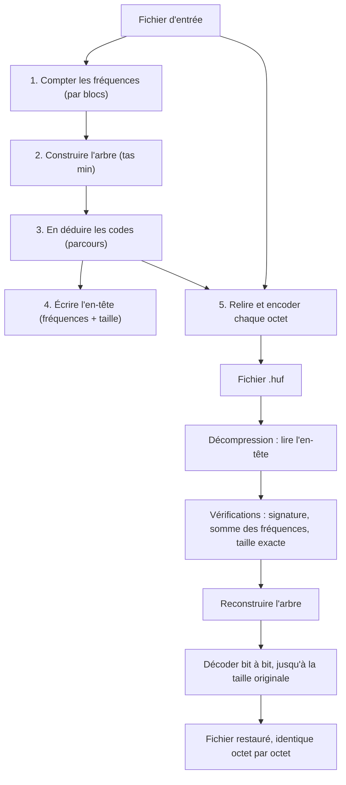

# Projet 2 — Compresseur de fichier avec l'algorithme de Huffman

## 1. Identification

- **Étudiant 1 :** Romain CHEN
- **Étudiant 2 :** Mohammed MOUSSAOUI
- **Enseignante :** E. SABAHI — Informatique MP2I
- **Projet :** Projet 2 du cahier des charges, compresseur de fichier avec l'algorithme de Huffman
- **Langage :** C (standard C11, sans extension propre à un compilateur)
- **Dépôt GitHub :** https://github.com/Answy-L/MP2I-Informatique (dossier `projet_huffman/`)
- **Date du dernier commit avant rendu :** ⚠️ à compléter après le commit final
- **Date limite du cahier des charges :** dimanche 8 novembre 2026, 23 h 59. Cette date est **déjà passée** : ce projet n'a pas été rendu à temps.

## 2. Présentation

Ce programme compresse et décompresse **n'importe quel fichier binaire** (texte, image, données quelconques) **sans perte** : décompressé, le fichier est identique octet par octet à l'original. L'algorithme de Huffman remplace chaque octet par un code binaire d'autant plus court que l'octet est fréquent.

Fonctionnalités réellement implémentées :

| Fonctionnalité | Détail |
|---|---|
| Analyse des fréquences | comptage des occurrences des 256 octets possibles, lecture par blocs de 64 Kio (le fichier n'est jamais chargé en entier en mémoire) |
| Arbre de Huffman | construction gloutonne avec une **file de priorité (tas min)**, départage déterministe des ex æquo |
| Codes binaires | produits par un parcours de l'arbre, stockés bit par bit (jusqu'à 255 bits par code) |
| Compression | en-tête autonome + flux de bits compacté (bits de bourrage ignorés à la décompression grâce à la taille originale) |
| Décompression | reconstruction de l'arbre depuis les fréquences, décodage bit à bit, arrêt exact au bon octet |
| Interface CLI | `huffman -c entrée sortie.huf`, `huffman -d entrée.huf sortie`, `huffman --help`, statistiques avant/après |
| Robustesse | vérification de `fopen`, `malloc`, `fread`, `fwrite`, `fclose`, refus des fichiers corrompus (signature, troncature, métadonnées incohérentes, octets superflus), refus d'écraser le fichier d'entrée, vérification des débordements d'entiers |

## 3. Analyse

### Besoins fonctionnels

1. Lire un fichier et compter la fréquence de chaque octet (les données sont traitées comme **binaires**, pas comme du texte : un `unsigned char` de 0 à 255).
2. Construire l'arbre binaire de Huffman à partir des fréquences.
3. En déduire un code binaire par symbole et l'utiliser pour encoder le fichier.
4. Écrire un fichier compressé **autonome** : il contient tout ce qu'il faut pour se décompresser lui-même.
5. Relire le fichier compressé, reconstruire l'arbre et reproduire exactement le fichier d'origine.

### Contraintes

- **Mémoire** : lecture par blocs de 64 Kio ; aucune structure ne dépend de la taille du fichier (l'arbre a au plus 511 nœuds, la table des fréquences 256 entrées).
- **Portabilité** : l'en-tête est écrit **octet par octet** en petit-boutiste ; jamais de `fwrite` direct d'une structure C (remplissage et ordre des octets dépendants de la machine).
- **Correctesse** : vérification des débordements quand on additionne des fréquences, des tailles ou des nombres de bits ; codes de sortie à 0 en cas de succès, 1 en cas d'échec.
- **Pédagogique** : code compréhensible en MP2I, commenté en français, découpage simple en trois modules.

### Cas particuliers et limites

- **Fichier vide** : compression et décompression réussies, sortie vide (le fichier compressé se réduit à son en-tête de 2060 octets).
- **Un seul octet, un seul symbole répété** : code conventionnel d'un bit (« 0 ») attribué au symbole unique.
- **Tous les octets 0 à 255**, y compris `0x00` et les valeurs supérieures à `0x7F` : traités comme n'importe quelles données binaires.
- **Fichier incompressible** (déjà compressé, aléatoire) : le résultat est plus gros que l'original à cause de l'en-tête ; l'opération reste correcte.
- **Limite assumée** : l'en-tête de 2060 octets fait perdre de la place sur les petits fichiers (le gain ne commence qu'au-delà de quelques kilo-octets de données compressibles).
- **Limite assumée** : le format stocke les fréquences en clair plutôt que l'arbre compacté ; c'est plus simple et robuste, au prix d'un en-tête de taille fixe.

## 4. Conception

### Structures de données

```c
/* Nœud de l'arbre (src/huffman.c) */
typedef struct Noeud {
    int symbole;              /* 0 à 255 pour une feuille, -1 sinon */
    uint64_t frequence;       /* occurrences (feuille) ou somme (nœud interne) */
    struct Noeud *gauche;     /* bit 0 */
    struct Noeud *droite;     /* bit 1 */
} Noeud;

/* Code d'un symbole (include/huffman.h) */
typedef struct {
    uint8_t longueur;   /* nombre de bits utiles (0 = symbole absent) */
    uint8_t bits[32];    /* 256 bits disponibles : la profondeur ne dépasse pas 255 */
} CodeHuffman;
```

Tous les nœuds vivent dans **un seul pool** alloué d'un bloc (au plus 256 feuilles + 255 nœuds internes = 511) : une seule libération, aucune fuite possible, pas de libérations récursives.

### Construction de l'arbre (tas min)

La file de priorité est un **tas min binaire** (tableau + remontée/descente) :

1. créer une feuille par symbole présent et l'insérer dans le tas ;
2. tant qu'il reste au moins deux nœuds : extraire les deux plus petites fréquences, les fusionner sous un nouveau nœud interne (fréquence = somme, vérifiée contre le débordement), remettre le parent dans le tas ;
3. le dernier nœud restant est la racine.

À fréquence égale, les nœuds sont départagés par ordre de création : l'arbre est **reproductible** (les mêmes fréquences donnent toujours le même arbre, donc le même fichier compressé).

### Construction des codes

Un parcours récursif de l'arbre note le chemin : 0 à gauche, 1 à droite. Chaque feuille atteinte reçoit son chemin comme code. Les codes sont **préfixes** : aucun code n'est le début d'un autre, c'est ce qui permet de décoder sans séparateur.

### Encodage et décodage bit à bit (`src/bit_io.c`)

- **Écriture** : les bits s'empilent dans un octet, du bit de poids fort vers le bit de poids faible ; l'octet plein est écrit dans le flux. Le dernier octet incomplet est complété par des zéros (bourrage).
- **Lecture** : chaque octet lu est décomposé en 8 bits dans le même ordre.
- Le décodeur sait quand s'arrêter grâce à la **taille originale stockée dans l'en-tête** : il produit exactement ce nombre d'octets et ignore le bourrage.

### Format du fichier compressé (versionné « HUF1 »)

| Position | Contenu | Taille |
|---|---|---|
| +0 | signature `HUF1` | 4 octets |
| +4 | taille originale du fichier | 8 octets, petit-boutiste |
| +12 | fréquence de chaque octet 0 à 255 | 256 × 8 octets, petit-boutistes |
| +2068 | flux de bits Huffman (poids fort en premier) | `ceil(nb_bits / 8)` octets |

L'en-tête fait toujours 2060 octets. Tout champ est écrit et lu **octet par octet** : le format est indépendant de l'architecture.

### Schéma du fonctionnement global



### Pseudocode

```
COMPRESSLER(entree, sortie) :
    freq = compter_frequences(entree)          # 1re passe
    arbre = tas_min(feuilles de freq)           # fusions gloutonnes
    codes = parcours(arbre)                    # 0 à gauche, 1 à droite
    ecrire "HUF1", taille(entree), freq        # en-tête
    pour chaque octet o de entree :            # 2e passe
        ecrire_bits(codes[o])
    compléter le dernier octet avec des 0

DECOMPRESSLER(entree, sortie) :
    vérifier la signature "HUF1"
    taille, freq = lire l'en-tête
    si somme(freq) != taille : refuser          # métadonnées incohérentes
    arbre = reconstruire(freq)
    si taille_du_fichier != 2060 + ceil(nb_bits / 8) : refuser
    n = racine ; octets_écrits = 0
    tant que octets_écrits < taille :
        n = racine
        tant que n n'est pas une feuille :
            n = (bit lu == 0) ? n.gauche : n.droite
        écrire n.symbole ; octets_écrits++
```

## 5. Démarche de réalisation

Étapes réellement suivies (le développement a eu lieu le **10/11/2026**, donc après la date limite du cahier des charges) :

1. **Audit du dépôt** : lecture du dépôt GitHub et de son historique avant toute modification ; constat que le dépôt décrit alors le projet robot (Python/Arduino) présenté comme validé par l'enseignante, alors que le sujet demandé ici est le compresseur Huffman. Décision, pour ne rien détruire : le projet Huffman vit dans un dossier séparé `projet_huffman/`, sans toucher aux fichiers existants ni à l'historique.
2. **Spécification du format HUF1** avant d'écrire le code (en-tête versionné, octet par octet, taille originale pour ignorer le bourrage).
3. **Implémentation** module par module : `bit_io` (écriture/lecture bit à bit), puis `huffman` (fréquences, tas min, arbre, codes, compression, décompression), puis `main` (CLI, aide, statistiques).
4. **Compilation avec les avertissements stricts** demandés (`-Wall -Wextra -Wpedantic -Wconversion -Wshadow`) et correction de tout avertissement jusqu'à une compilation silencieuse.
5. **Tests** : suite de 25 vérifications automatisées, tous passés, puis reprise complète de la suite avec un binaire compilé avec UBSan.
6. **Documentation** : ce README, le guide pour l'oral (`docs/explication_orale.md`) et le mode d'emploi des tests (`tests/README.md`).

Choix techniques et justifications :

- **Tas min plutôt que tri répété** : le cahier des charges demande une file de priorité ; le tas donne O(n log n) au lieu de O(n²) et reste court à expliquer (une page de code).
- **Pool de nœuds** : au lieu d'un `malloc` par nœud, un seul tableau, une seule libération ; moins d'occasions de fuite, parcours de destruction inutile.
- **Fréquences dans l'en-tête plutôt que l'arbre sérialisé** : reconstruction triviale et vérifiable (somme des fréquences = taille annoncée), au prix d'un en-tête de 2060 octets, taille fixe et documentée.
- **Rejets stricts à la décompression** (fichier plus court **ou plus long** que prévu) : un fichier HUF1 a une taille exactement prévisible ; tout écart signale une corruption.

Difficultés réellement rencontrées :

- **gcc indisponible dans l'environnement de développement** : compilation validée avec clang 18.1.6 (via `zig cc`) avec les mêmes options strictes ; le Makefile reste prévu pour gcc/clang standard.
- **AddressSanitizer non disponible dans cet environnement** (pas de runtime pour la cible) : la mémoire a été vérifiée à la relecture du code (une seule zone allouée par structure, libérée sur tous les chemins, y compris d'erreur) et par UBSan ; valgrind n'a pas pu être exécuté.
- **`make` indisponible dans l'environnement de développement** : les commandes du Makefile ont été exécutées à l'identique à la main ; `make test` doit être vérifié sur une machine standard du binôme.

## 6. Compilation et utilisation

### Prérequis

- un compilateur C11 : `gcc` ou `clang` (le projet a été validé avec clang 18.1.6 ; gcc n'a pas été disponible dans l'environnement de développement),
- `make`,
- pour la suite de tests : `bash`, `cmp`, `mktemp`, et `python3` (facultatif : sans lui, 3 tests générés et 4 tests de corruption sont simplement signalés « SAUTÉS »).

### Linux / macOS / WSL

```bash
cd projet_huffman
make                 # compile le binaire « huffman »
make debug           # compile « huffman-debug » avec UBSan
make test            # exécute toute la suite de tests
make clean           # supprime les fichiers générés
```

### Windows

Le Makefile cible un environnement Unix (Linux, macOS, WSL). Sous Windows, le plus simple est d'utiliser **WSL** (déjà utilisé par le binôme pour le TP). Une compilation native sous MinGW n'a **pas** été testée.

### Exemples

```bash
./huffman -c texte.txt texte.huf      # compresse
./huffman -d texte.huf texte2.txt     # décompresse
./huffman --help                      # aide
```

Sortie typique (`-c`) :

```
Compression de « symbole_unique.txt » réussie.
  Taille originale : 4000 octets
  Taille compressée totale : 2560 octets (en-tête : 2060 octets, flux codé : 500 octets)
  Taux de compression : 36.0 %
```

La taille compressée totale inclut l'en-tête de 2060 octets ; le « flux codé » est la donnée encodée seule. Pour un fichier vide, le taux n'est pas affiché (division par zéro évitée). En cas d'échec, un message explicite va sur la sortie d'erreur et le code de sortie vaut 1.

## 7. Tests

Mode d'emploi détaillé : voir `tests/README.md`. Résumé de la commande : `make test` (ou `bash ./tests/test_huffman.sh`).

### Résultats réellement obtenus (exécution du 10/11/2026)

Compilateur : clang 18.1.6, options `-std=c11 -Wall -Wextra -Wpedantic -Wconversion -Wshadow -O2`, compilation sans aucun avertissement. Comparaison octet par octet par `cmp`. **25 tests OK, 0 échec, 0 sauté** (binaire normal **et** binaire UBSan).

| # | Entrée | Résultat attendu | Résultat obtenu |
|---|---|---|---|
| 1 | fichier vide (0 octet) | aller-retour réussi, sortie vide | OK (compressé : 2060 octets, en-tête seul) |
| 2 | 1 octet (`a`) | restauré identique | OK (flux codé : 1 octet) |
| 3 | un symbole ×4000 (`a`×4000) | restauré identique, code d'un bit | OK (4000 → 500 octets de flux, 36,0 %) |
| 4 | texte court (78 octets) | restauré identique | OK (flux : 39 octets) |
| 5 | texte avec accents, ponctuation, tabulations, sauts de ligne | restauré identique | OK (flux : 119 octets) |
| 6 | tous les octets 0 à 255 (×40, 10 240 octets) | restauré identique | OK (flux : 10 240 octets, aucun gain : distribution uniforme) |
| 7 | 100 000 octets pseudo-aléatoires (graine 42) | restauré identique | OK (flux : 100 000 octets, incompressible, correct) |
| 8 | fichier volumineux (5,8 Mo, motif répété) | restauré identique | OK (2 425 000 octets de flux, 58,2 %) |
| 8b | fichier **déjà compressé** recompressé | aller-retour double correct | OK (100 000 → 102 060 → 103 910 octets) |
| 9 | compressé tronqué (5 octets) | refus propre, code 1 | OK (refusé) |
| 9b | en-tête tronqué | refus propre | OK (refusé) |
| 10 | mauvaise signature (`XXXX`) | refus propre | OK (refusé) |
| 11 | entrée inexistante (`-c` et `-d`) | erreur propre, code 1 | OK (refusé) |
| 12 | aucun argument / option inconnue / argument manquant / `--help` | aide et code non nul ; `--help` code 0 | OK |
| 13 | entrée et sortie identiques (`-c` et `-d`) | refus, fichier d'origine intact | OK (refusé, fichier intact) |
| 14 | fréquence modifiée / taille modifiée / octets superflus | métadonnées incohérentes refusées | OK (refusés) |

### Vérifications mémoire et outils utilisés

- **UBSan** (`-fsanitize=undefined`) : toute la suite exécutée avec le binaire instrumenté, 25/25 OK, aucun diagnostic émis.
- **AddressSanitizer : non exécuté** (runtime indisponible dans l'environnement de développement ; gcc/clang complets non installables).
- **valgrind : non exécuté** (outil indisponible dans l'environnement de développement).
- La gestion mémoire a été vérifiée par relecture : chaque allocation (`pool`, tas, codes, tampons) est libérée sur les chemins de succès **et** d'erreur ; un seul propriétaire par zone.

## 8. Bilan

### Limites réelles

- L'en-tête fixe de 2060 octets pénalise les petits fichiers et les fichiers incompressibles (documenté, assumé).
- Le format stocke les fréquences (256×8 octets) et non un arbre compacté : plus simple, mais moins compact.
- Pas de mode « texte » spécifique : tout est traité en binaire (c'est plus général).
- L'entrée doit être un fichier ordinaire (relecture depuis le début nécessaire à la compression) : un tube (`stdin`) ne fonctionne pas.

### Améliorations possibles

- Sérialiser l'arbre en **préordre compact** (2 bits par nœud) pour réduire l'en-tête.
- Ajouter `--stdout`/`--stdin` pour les tubes.
- Compresser par blocs ou coupler à un algorithme type LZ77 (approche DEFLATE).

### Répartition effective du travail

⚠️ Tableau à remplir par le binôme sur la base du travail **réellement** réalisé. La première version du code a été écrite le 10/11/2026 avec l'aide d'un assistant IA (Vibe, Mistral AI) à la demande de Romain ; la répartition de la relecture, de la compréhension et des ajustements éventuels par chacun doit être confirmée par le binôme avant le rendu.

| Tâche | Responsable principal | Contribution de l'autre membre | Fichiers ou commits associés |
|---|---|---|---|
| Analyse et conception | À confirmer | À confirmer | À renseigner |
| Structures de données | À confirmer | À confirmer | À renseigner |
| Algorithmes Huffman | À confirmer | À confirmer | À renseigner |
| Interface CLI | À confirmer | À confirmer | À renseigner |
| Gestion mémoire et erreurs | À confirmer | À confirmer | À renseigner |
| Tests et validation | À confirmer | À confirmer | À renseigner |
| README et relecture | À confirmer | À confirmer | À renseigner |

### Bilan individuel

**Romain CHEN** — *à compléter* : tâches effectivement réalisées, difficultés rencontrées, solutions trouvées, apprentissages.

**Mohammed MOUSSAOUI** — *à compléter* : tâches effectivement réalisées, difficultés rencontrées, solutions trouvées, apprentissages.

---

⚠️ **Rappel important** : au 10/11/2026, le README racine du dépôt décrit le projet robot (Python/Arduino) comme le sujet validé par l'enseignante le 03/11/2026. Avant tout rendu, le binôme doit **confirmer avec Mme SABAHI** quel sujet doit être rendu, et tenir compte du fait que la date limite du 8/11/2026 est dépassée pour les deux sujets.
